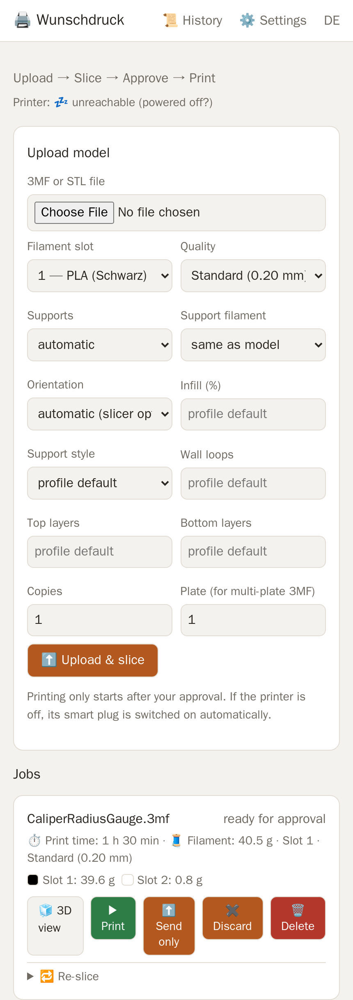
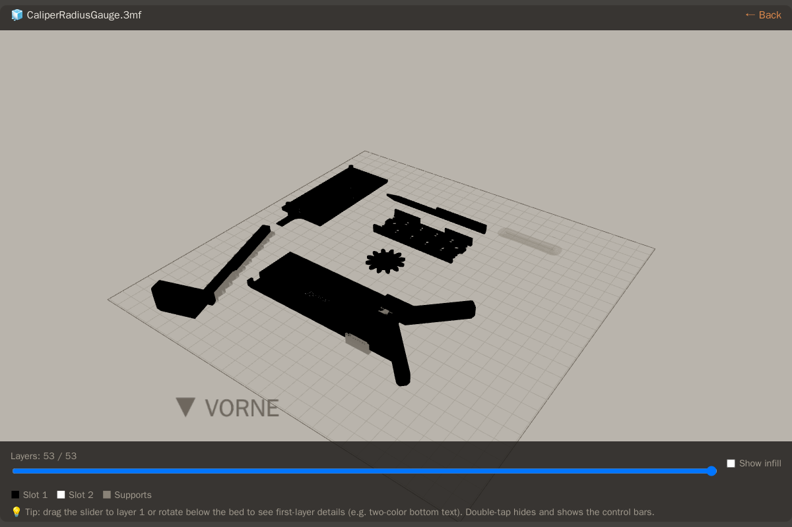
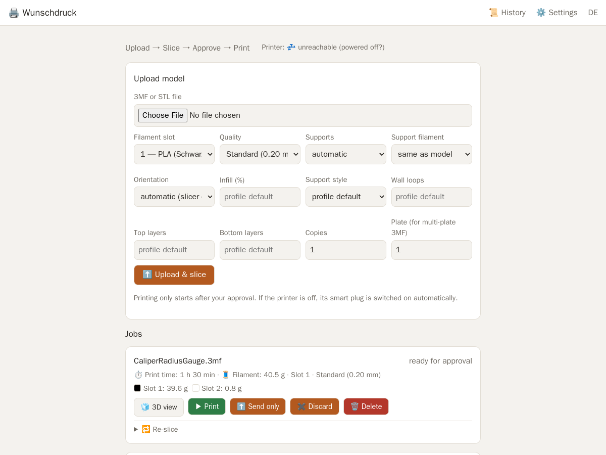

# Wunschdruck

**Hochladen → Slicen → Freigeben → Drucken.** Eine handytaugliche, selbst
gehostete Web-App, die einen **Snapmaker U1** zum „einfach an den Drucker
schicken"-Gerät macht: Headless-Slicing mit der OrcaSlicer-CLI und den
originalen U1-Profilen, Freigabe mit einem Tipp, und der Drucker schaltet sich
selbst ein.

English version: **[README.md](README.md)** · Lizenz: **AGPL-3.0**

<p align="center">
  
  
</p>

## Warum

Du findest am Handy ein Modell und willst es gedruckt haben. Du willst dafür
nicht den PC hochfahren, den Slicer öffnen, Profile wählen, exportieren und
zum Drucker laufen. Wunschdruck läuft auf einem kleinen Heimserver neben dem
Drucker: Datei aus dem Teilen-Menü des Handys schicken, Preset wählen,
**Drucken** tippen. Die App sliced mit Snapmakers eigenen U1-Profilen,
schaltet die Steckdose ein, lädt den G-Code über Moonraker hoch und startet.
Home Assistant meldet, wenn gesliced, gestartet und fertig ist.

Gebaut für einen Haushalt mit einem U1 auf Stock-Firmware. Veröffentlicht wie
es ist — vor allem, weil das Headless-Slicen mit der Orca-CLI für den U1 Tage
gekostet hat, siehe [Orca-CLI-Fallen](#orca-cli-fallen).

## Was drin ist

- **STL oder 3MF hochladen** im Browser oder direkt aus dem Teilen-Menü des
  Handys (PWA-Teilen-Ziel).
- **Presets**: PLA / PETG / TPU × Fein 0,12 / Standard 0,20 / Schnell 0,24 mm —
  die U1-Profile aus Snapmaker Orca. Je Auftrag: Stützen an/aus, Baum oder
  klassisch, Stützen-Filament-Slot, Füllung %, Wandlinien, Deck-/Bodenschichten,
  Ausrichtung (automatisch oder wie in der Datei), Stückzahl, Platte bei
  Mehrplatten-3MFs.
- **Eigene Druckprofile**: Prozess-Preset aus Snapmaker Orca am PC exportieren,
  in den Einstellungen importieren — landet in der Qualitäts-Auswahl.
- **Mehrfarb-3MFs** (MakerWorld-/Bambu-/Orca-Projekte mit bemalten Farben): die
  App liest die Projektfarben und lässt jede Farbe einem physischen Slot 1–4
  zuordnen. Der Prime-Tower bleibt an, wie die U1-Profile es vorsehen.
- **Rollen-Lager und Slots**: Jede Rolle, die du besitzt, ist ein Eintrag
  (Material, Farbe, Hersteller, Nettogewicht, Rest in Gramm, Kaufdatum, Notiz)
  mit eigenem Verlauf; die vier Drucker-Slots bestückst du aus dieser Liste.
  Jeder fertige Wunschdruck-Druck geht automatisch von der Rolle im jeweiligen
  Slot ab — egal ob aus der App oder am Drucker gestartet, Abbrüche anteilig
  (Moonraker-Historie, genau einmal verbucht). Die Startseite zeigt den Rest
  je Slot, und eine Job-Karte warnt, wenn sie mehr braucht, als die Rolle noch
  hat. Ist der Drucker erreichbar, vergleicht jede Job-Karte außerdem die
  benötigten Slots mit dem, was *tatsächlich* geladen ist (Moonraker
  `print_task_config`), und warnt vor der Freigabe.
- **3D-Vorschau des gesliceten G-Codes**: echte Lage auf der 270 × 270-Platte,
  Ebenen-Regler, Farben je Slot, Stützen transluzent, Füllung zuschaltbar, Blick
  unter die Platte für Erstschicht-Text. three.js, läuft auf dem Handy.
- **Freigabe-Workflow**: beim Hochladen druckt nichts. Knöpfe: Drucken · Nur
  senden (G-Code hochladen, Start am Gerät) · Verwerfen · Löschen · Neu slicen
  mit geänderten Einstellungen.
- **Strom-Kette über Home Assistant**: Steckdose an → auf Moonraker warten →
  hochladen → starten. Ein Wartungsriegel (`input_boolean`) blockiert das
  Einschalten, fail-closed.
- Live-Fortschritt mit Restzeit, Druck-Historie aus Moonraker, Verbrauch je
  Slot, automatisches Aufräumen alter Aufträge.
- Meldungen über jeden HA-Notify-Dienst (Telegram, Mobile App, …): gesliced,
  gestartet, fertig, fehlgeschlagen.
- **Modelle finden**: Link-Kacheln für MakerWorld, Thingiverse und Printables
  (im Browser laden, dann die Datei in die App teilen) und eine Suche direkt in
  Wunschdruck — Thingiverse mit App-Token, Printables per Flag: Treffer mit
  Bildern, Modellseite mit Lizenz und Autor, STL/3MF auswählen, Auftragsoptionen
  setzen, fertig — die Datei landet direkt im Container und wird gesliced.
  Printables hat keine offizielle API; Wunschdruck spricht die GraphQL-
  Schnittstelle des Web-Frontends an (ohne Token, Download zählt beim Designer
  wie im Browser) — das kann ohne Vorwarnung brechen, deshalb abschaltbar.
- Oberfläche Deutsch / Englisch, optionale Kamera-Stream-URL.

<p align="center">
  
</p>

## Wie es funktioniert

FastAPI + SQLite + zwei Arbeits-Threads (Slice-Warteschlange, Drucker-Kette),
ein Docker-Container. Zwei Slicer laufen darin als reine CLI-Binaries:

| Engine | Zuständig für | Warum |
|---|---|---|
| Snapmaker Orca `V2.3.6` (Fork) | einfarbige Aufträge | bringt Maschinen-, Prozess- und Filamentprofile des U1 mit |
| Vanilla OrcaSlicer `2.4.2` | bemalte Multi-Extruder-Projekte | die Fork-CLI stürzt bei jedem bemalten Multi-Extruder-3MF ab |

Vendor-Profile werden flachgezogen (`inherits` aufgelöst) und von Schlüsseln
befreit, die die CLI crashen. Die App spricht mit dem eingebauten Moonraker
des U1 (Port 7125, ohne API-Key auf Stock-Firmware) für Upload, Start,
Fortschritt und Historie.

## Voraussetzungen

- Snapmaker U1 mit Stock-Firmware im selben LAN wie der Server.
- x86_64-Linux-Host mit Docker (die Slicer-AppImages sind x86_64). Einmaliger
  Download beider Slicer, rund 1,3 GB, liegt außerhalb von Git.
- Optional: Home Assistant mit Notify-Dienst, Steckdosen-Switch und einem
  `input_boolean` als Wartungsriegel. Passt zu
  [snapmaker-u1-homeassistant](https://github.com/Meisterull/snapmaker-u1-homeassistant),
  das die U1-spezifischen Sensoren und eine sichere Aus-Schaltkette mitbringt.

## Installation

```bash
git clone https://github.com/Meisterull/wunschdruck.git
cd wunschdruck
slicer/holen.sh              # lädt und entpackt beide Slicer-AppImages
cp .env.example .env         # MOONRAKER_URL setzen, optional die HA_*-Schlüssel
docker compose up -d --build
```

Dann `http://<host>:8446` öffnen. Aufträge, Profil-Cache und importierte
Profile liegen im benannten Volume `wunschdruck-daten`.

**HTTPS** braucht es für die PWA-Installation und das Teilen-Ziel (Browser
bieten beides nur im sicheren Kontext an). Eine `docker-compose.override.yml`
mountet das Zertifikat und reicht es an uvicorn weiter; die App dann über den
Namen aus dem Zertifikat aufrufen:

```yaml
services:
  wunschdruck:
    volumes:
      - /pfad/zu/fullchain.pem:/ssl/fullchain.pem:ro
      - /pfad/zu/privkey.pem:/ssl/privkey.pem:ro
    command: ["/venv/bin/uvicorn", "app.haupt:app", "--host", "0.0.0.0", "--port", "8446",
              "--ssl-certfile", "/ssl/fullchain.pem", "--ssl-keyfile", "/ssl/privkey.pem"]
```

### Sicherheit

Es gibt **kein Login**. Die App ist für ein vertrauenswürdiges Heimnetz
gedacht: Wer Port 8446 erreicht, kann Drucke starten und den Drucker
einschalten. Nicht ins Internet stellen; wenn es sein muss, hinter einen
Reverse-Proxy mit Authentifizierung.

## Home Assistant

Alles rund um HA ist optional und best-effort — ein HA-Ausfall blockiert nie
das Slicen. Schlüssel in `.env`:

| Schlüssel | Bedeutung |
|---|---|
| `HA_URL`, `HA_TOKEN` | HA-Basis-URL und langlebiges Zugriffstoken |
| `THINGIVERSE_TOKEN` | optional: App-Token von thingiverse.com/developers — schaltet die Thingiverse-Suche samt Download in der App frei |
| `PRINTABLES_SUCHE` | optional: `1` schaltet die Printables-Suche frei — inoffizielle Frontend-Schnittstelle ohne Token, bei Ausfall auf `0` |
| `HA_NOTIFY` | Notify-Dienst für Meldungen, z. B. `notify.mobile_app_handy` |
| `HA_SWITCH` | Steckdose des Druckers, z. B. `switch.drucker_steckdose` |
| `HA_WARTUNGSRIEGEL` | `input_boolean`-Wartungsriegel; wenn an, verweigert die App das Einschalten |
| `EINSCHALT_TIMEOUT_S` | Wartezeit auf Moonraker nach dem Einschalten (Standard 300) |

Ohne HA schaltest du den Drucker selbst ein; der Rest funktioniert unverändert.

## Orca-CLI-Fallen

Alles hier unten wurde teuer gelernt und ist im Code behandelt. Wer die
Orca-CLI selbst headless für einen U1 fährt, spart mit dieser Liste vielleicht
eine Woche.

- **Vendor-Profile nutzen `inherits`, die CLI löst es nicht auf** und bricht
  ab. Erst flachziehen — `werkzeuge/profil_flatten.py` baut einen Index über
  das `name`-Feld der Snapmaker- und OrcaFilamentLibrary-Ordner.
- **`wipe_tower_filament` im Prozessprofil segfaultet die CLI.** Per
  Delta-Debugging gefunden (`proben/prozess_bisect.py`); der Flattener wirft
  den Schlüssel raus, auch aus Einstellungen, die in hochgeladenen 3MFs
  stecken (`CLI_GIFTIG`).
- `--export-3mf` will einen Namen **relativ** zu `--outputdir`; ein absoluter
  Pfad ergibt einen doppelten Pfad.
- Druckzeit und Filamentverbrauch stehen je nach Lage im G-Code-**Fußteil**,
  nicht im Kopf — die ganze Datei scannen.
- Slot *N*: *N* Einträge in `--load-filaments` plus `--load-filament-ids N`;
  der G-Code nutzt dann `T(N-1)`. **Nicht bei 3MF:** Mit `--load-filament-ids` oder
  `--clone-objects` lehnt die CLI jedes 3MF ab („can not load 3mf when set
  loaded_filament_ids or clone_objects“). Wunschdruck schreibt den Slot stattdessen
  in die `model_settings.config` des Projekts und wandelt schlichte 3MFs (oder jedes
  3MF mit Stückzahl > 1) in STL.
- **Orca dedupliziert `--load-filaments` nach dem `name`-Feld.** Viermal
  dasselbe „Generic PLA" lässt den Drucker einfarbig aussehen, und der
  Prime-Tower verschwindet still. Jedem Slot eine eindeutig benannte Kopie
  geben.
- **Die CLI von Snapmaker Orca V2.3.6 stürzt bei jedem bemalten
  Multi-Extruder-Projekt ab** (`GUI_App::filaments_cnt()` ist in der CLI null,
  erreicht über `expand_plate_extruders`; mit gdb belegt, kein Input-Workaround).
  Vanilla OrcaSlicer 2.4.2 sliced sie mit denselben flachen U1-Profilen; nur
  die Fork-eigene G-Code-Variable `chamber_cooling_mode` muss literalisiert
  werden.
- Bemalte Dreiecke tragen `paint_color`-Codes: den Bitstrom von PrusaSlicers
  `TriangleSelector`, Hex-Ziffern **rückwärts** gelesen, je 4 Bit. Ein ganz
  bemaltes Dreieck ist `4` = Filament 1, `8` = 2, `0C` = 3, `1C` = 4 — also
  *nicht* „Filament × 4": ein `10` für Filament 4 dekodiert der Slicer als
  *unbemalt*, und die Farbe verschwindet still. `app/dreimf.py` dekodiert und
  kodiert den ganzen Baum, darum lassen sich auch fein gepinselte Bereiche
  ummappen.
- **Headless schreibt die CLI keine Thumbnails** (kein GL-Kontext), und der
  U1-Touchscreen zeigt zum Job dann nur einen Platzhalter. Die App rendert
  eigene PNGs aus den gesliceten Bahnen (`app/miniatur.py`, Pillow) und fügt
  hinter dem Header einen Orca-üblichen `; thumbnail begin WxH`-Block ein —
  Moonraker liest ihn wie bei einer Desktop-Datei.
- **`filament_colour` im G-Code hat nichts mit den Slots zu tun.** Der Fork
  schreibt bei STLs seinen Profil-Standard (`#F2754E`), ein Projekt-3MF behält
  seine Original-Farbliste (aus einem Bambu-PVA-Slot wurde `#00000000`). Der
  U1 gleicht G-Code-Filamente über Typ *und Farbe* mit den geladenen Slots ab
  und schlug darum bei einem Zweifarbdruck für beide Farben Slot 1 vor. Die
  App schreibt die Slot-Farben aus den Einstellungen in die Slot-Profile und
  als Sicherheitsnetz in `filament_colour`/`extruder_colour` des
  G-Code-Konfigblocks.
- Projekt-3MFs aus einem neueren Slicer brauchen `--allow-newer-file`.
- `--clone-objects N` ist die **Gesamt**zahl; `--repetitions` lehnt den
  Platten-Modus ab.
- `--orient 1` kann ein Modell umdrehen (ein Pilz-Testdruck stand kopfüber und
  verlor seine Stützen). `--arrange` muss an bleiben, sonst liegen die
  Ursprungskoordinaten der Datei außerhalb des Bauraums.
- Vanilla hat Arc-Fitting an (G2/G3); die App schaltet `enable_arc_fitting`
  aus, weil die Bogen-Unterstützung im Klipper des U1 ungeklärt ist.
- `raft_first_layer_expansion` unter 0 (Bambu-Profile nutzen −1) scheitert an
  der CLI-Validierung — auf 0 klemmen.

## Projektaufbau

```
app/            FastAPI-App: haupt.py (Routen), worker.py (Slice-Warteschlange + Drucker-Kette),
                slicer.py (Orca-CLI), dreimf.py (3MF-Farbanalyse), vorschau.py (G-Code → Vorschau),
                moonraker.py, ha.py, db.py, i18n.py, konfig.py, vorlagen/ (Jinja2), statisch/ (Assets)
werkzeuge/      profil_flatten.py (Profil-Flattener), symbol_bauen.py (PWA-Symbole)
slicer/holen.sh lädt + entpackt beide Slicer-AppImages (Binaries sind gitignored)
proben/         die Probe-Skripte, die die CLI-Abstürze eingegrenzt haben
tests/          winzige STL-Fixtures (20-mm-Würfel, Pilz mit Überhang)
```

## Stand

Junges Projekt (September 2026), ein Drucker, ein Haushalt. Ende-zu-Ende
verifiziert: Upload, ein- und mehrfarbiges Slicen an echten
MakerWorld-Projekten, G-Code-Prüfung, 3D-Vorschau, Profil-Import, Neu-Slicen.
Zum Zeitpunkt der Veröffentlichung noch nicht ausgeführt: ein echter
Druckstart über die App (die Moonraker-Upload-/Start-Kette spiegelt die
Aufrufe, die das HA-Paket des U1 produktiv nutzt) und der Live-Filamentabgleich
gegen einen eingeschalteten Drucker. Der „VORNE"-Marker der 3D-Ansicht nimmt
an, dass Y = 0 die Türseite ist. Issues und Rückmeldungen anderer U1-Besitzer
sind willkommen.

## Dank

- [OrcaSlicer](https://github.com/OrcaSlicer/OrcaSlicer) und
  [Snapmaker Orca](https://github.com/Snapmaker/OrcaSlicer) (AGPL-3.0) — als
  externe Binaries genutzt, geladen von `slicer/holen.sh`, nicht gebündelt.
- [three.js](https://threejs.org/) r147 und OrbitControls (MIT) — gebündelt in
  `app/statisch/`.
- [Moonraker](https://github.com/Arksine/moonraker) — die API, die der U1 spricht.

## Lizenz

AGPL-3.0 — siehe [LICENSE](LICENSE). Snapmaker und OrcaSlicer sind Marken
ihrer jeweiligen Inhaber; dieses Projekt steht mit keinem von beiden in
Verbindung.
